# Books API – Sistem Pengelolaan Buku dan Peminjaman

- **Nama:** Alya Rasyida Putri
- **NIM:** F1D02410002
- **Program Studi:** Teknik Informatika

## Deskripsi Project

Books API merupakan aplikasi REST API untuk mengelola data buku dan peminjaman buku. Aplikasi ini dikembangkan menggunakan Express.js sebagai framework backend, MySQL sebagai database, dan Prisma ORM untuk mengelola interaksi dengan database.

Aplikasi ini menyediakan fitur CRUD (Create, Read, Update, Delete) untuk data buku serta pengelolaan transaksi peminjaman. Sistem juga dilengkapi dengan validasi input, pagination, filter pencarian buku, relasi antara buku dan peminjaman, serta transaksi database untuk memastikan perubahan stok berjalan secara konsisten.

## Teknologi yang Digunakan

- Node.js
- Express.js
- MySQL
- Prisma ORM
- Joi
- dotenv
- Postman

## Fitur Utama

1. **CRUD Buku**
   - Menambahkan data buku.
   - Menampilkan seluruh data buku.
   - Menampilkan detail buku berdasarkan ID.
   - Mengubah data buku.
   - Menghapus data buku.

2. **Pagination dan Filter**
   - Menampilkan data buku berdasarkan halaman.
   - Mengatur jumlah data dalam setiap halaman.
   - Mencari buku berdasarkan judul.

3. **Pengelolaan Peminjaman**
   - Menambahkan transaksi peminjaman buku.
   - Menampilkan seluruh data peminjaman beserta detail buku.

4. **Relasi Database**
   - Menggunakan relasi One-to-Many antara tabel Book dan Loan.
   - Satu buku dapat memiliki banyak riwayat peminjaman.

5. **Database Transaction**
   - Memeriksa ketersediaan buku.
   - Memeriksa kecukupan stok.
   - Menyimpan data peminjaman.
   - Mengurangi stok buku secara otomatis.
   - Menggunakan Prisma `$transaction` agar seluruh proses berhasil atau dibatalkan jika terjadi kesalahan.

6. **Validasi dan Error Handling**
   - Menggunakan Joi untuk memvalidasi input.
   - Middleware untuk menangani validasi.
   - Centralized error handler untuk menangani kesalahan.
   - Logger untuk mencatat method, URL, dan status response.

## Struktur Folder

```text
pwl26-mini-project/
│
├── prisma/
│   ├── migrations/
│   ├── schema.prisma
│   └── seed.js
│
├── src/
│   ├── controllers/
│   │   ├── book.controller.js
│   │   └── loan.controller.js
│   │
│   ├── data/
│   │   ├── book.data.js
│   │   └── loan.data.js
│   │
│   ├── middleware/
│   │   ├── errorHandler.js
│   │   ├── logger.js
│   │   └── validate.js
│   │
│   ├── routes/
│   │   ├── book.routes.js
│   │   └── loan.routes.js
│   │
│   ├── services/
│   │   ├── book.service.js
│   │   └── loan.service.js
│   │
│   ├── validators/
│   │   ├── book.validator.js
│   │   └── loan.validator.js
│   │
│   ├── prisma.js
│   └── server.js
│
├── screenshot/
├── .env.example
├── .gitignore
├── package.json
├── package-lock.json
├── prisma7.config.ts
└── README.md
```

## Persyaratan

Sebelum menjalankan aplikasi, pastikan perangkat sudah memiliki:

- Node.js dan npm.
- MySQL.
- Prisma CLI.
- Postman (untuk pengujian API).

## Instalasi dan Konfigurasi

**1. Clone repository**

```bash
git clone URL_REPOSITORY
```

Masuk ke folder project:

```bash
cd pwl26-mini-project
```

**2. Instal dependency**

```bash
npm install
```

**3. Konfigurasi database**

Buat database MySQL dengan nama:

```sql
CREATE DATABASE books_api;
```

**4. Konfigurasi environment**

Buat file `.env` pada folder utama project dan isi dengan konfigurasi berikut:

```env
DATABASE_URL="mysql://root@localhost:3306/books_api"
PORT=3000
```

Sesuaikan username, password, dan port MySQL dengan konfigurasi di komputer masing-masing.

**5. Menjalankan migration**

```bash
npx prisma migrate dev
```

**6. Generate Prisma Client**

```bash
npx prisma generate
```

**7. Menjalankan seed**

```bash
npx prisma db seed
```

Perintah tersebut digunakan untuk memasukkan data awal buku ke database.

**8. Menjalankan server**

```bash
npm run dev
```

Jika berhasil, terminal akan menampilkan:

```text
Server berjalan di http://localhost:3000
```

## Dokumentasi Endpoint API

Base URL:

```text
http://localhost:3000
```

### 1. Endpoint Buku (Books)

**GET /books**

Menampilkan seluruh data buku dengan pagination dan filter judul.

Parameter query:
- `halaman`: nomor halaman.
- `ukuran`: jumlah data per halaman.
- `judul`: filter berdasarkan judul buku.

Contoh:

```text
GET /books?halaman=1&ukuran=10&judul=Laskar
```

**GET /books/:id**

Menampilkan detail buku berdasarkan ID.

Contoh:

```text
GET /books/1
```

**POST /books**

Menambahkan data buku baru.

Contoh request body:

```json
{
  "title": "Negeri 5 Menara",
  "author": "Ahmad Fuadi",
  "isbn": "9786021234568",
  "year": 2009,
  "price": 85000,
  "stock": 10,
  "publishedAt": "2009-07-01"
}
```

**PUT /books/:id**

Mengubah data buku berdasarkan ID.

Contoh:

```text
PUT /books/1
```

Request body menggunakan format data buku yang sama dengan POST.

**DELETE /books/:id**

Menghapus data buku berdasarkan ID.

Contoh:

```text
DELETE /books/1
```

### 2. Endpoint Peminjaman (Loans)

**GET /loans**

Menampilkan seluruh data peminjaman beserta detail buku menggunakan Prisma `include`.

**POST /loans**

Membuat transaksi peminjaman sekaligus mengurangi stok buku.

Contoh request body:

```json
{
  "bookId": 1,
  "borrowerName": "Alya Rasyida Putri",
  "quantity": 2
}
```

Sistem akan memeriksa keberadaan buku dan ketersediaan stok sebelum menyimpan transaksi.

## Struktur Database

Aplikasi menggunakan dua tabel utama:

**1. Book**

Menyimpan informasi buku dengan atribut:
- id
- title
- author
- isbn
- year
- price
- stock
- publishedAt
- createdAt

**2. Loan**

Menyimpan informasi peminjaman dengan atribut:
- id
- bookId
- borrowerName
- quantity
- loanDate

Relasi antara kedua tabel adalah One-to-Many, yaitu satu buku dapat memiliki banyak data peminjaman.

## Pengujian API

Pengujian dilakukan menggunakan Postman untuk memastikan setiap endpoint berjalan sesuai fungsinya.

Hasil pengujian meliputi:

- 200 OK: pengambilan data berhasil.
- 201 Created: data berhasil ditambahkan.
- 204 No Content: data berhasil dihapus.
- 400 Bad Request: input tidak memenuhi validasi.
- 404 Not Found: data tidak ditemukan.
- 409 Conflict: ISBN sudah digunakan atau buku memiliki riwayat peminjaman.
- 422 Unprocessable Entity: stok buku tidak mencukupi.

### Dokumentasi Screenshot

**1. GET Semua Buku**

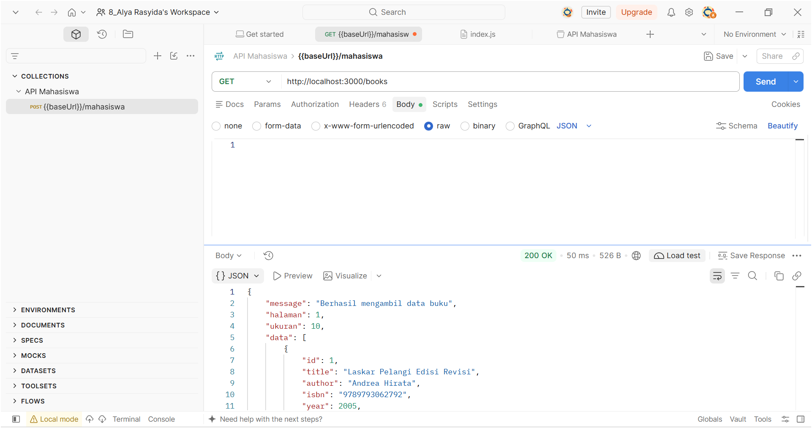

**2. GET Detail Buku**

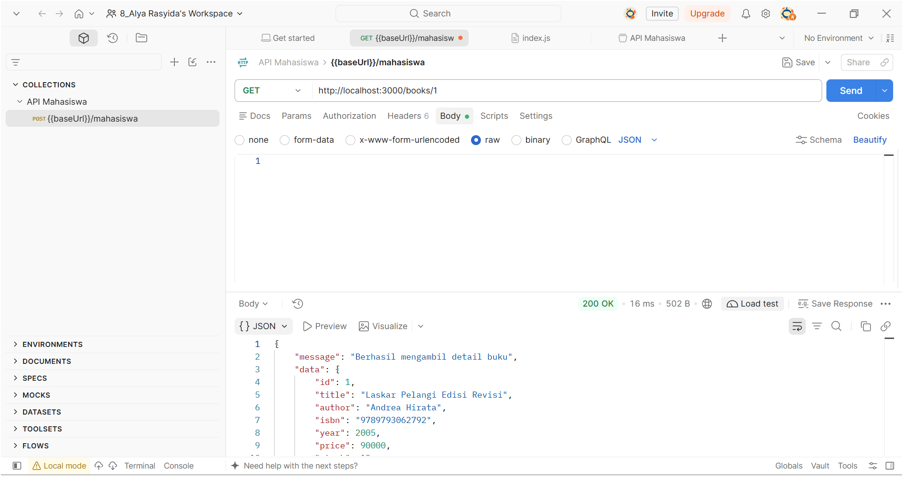

**3. POST Tambah Buku**

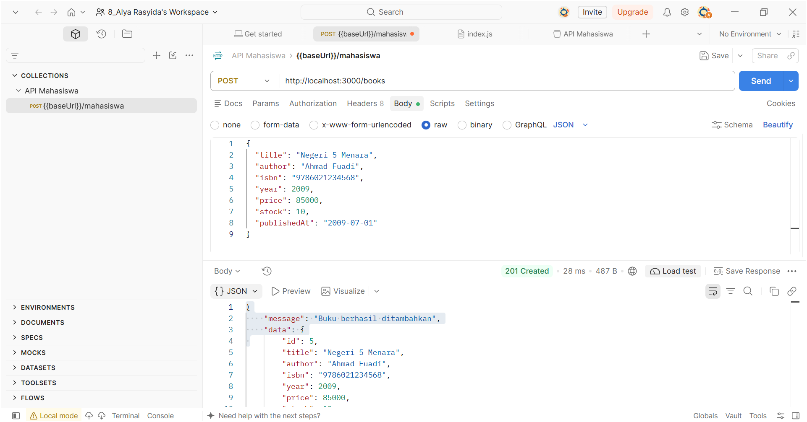

**4. PUT Ubah Buku**

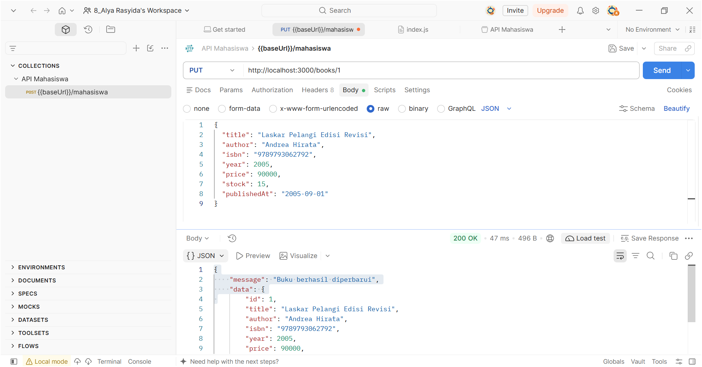

**5. DELETE Buku**

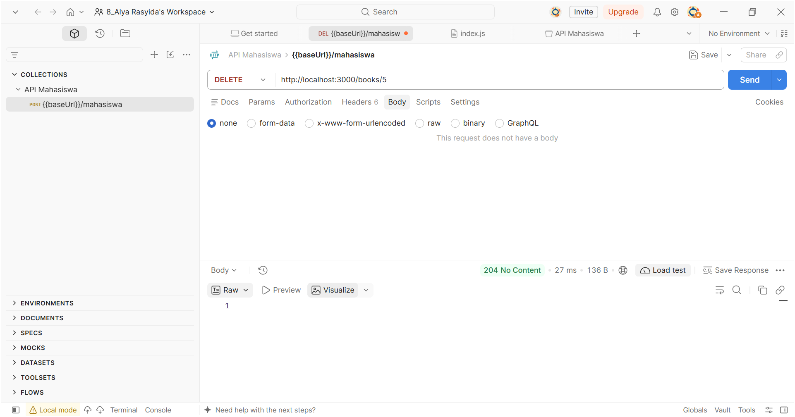

**6. GET Data Peminjaman**

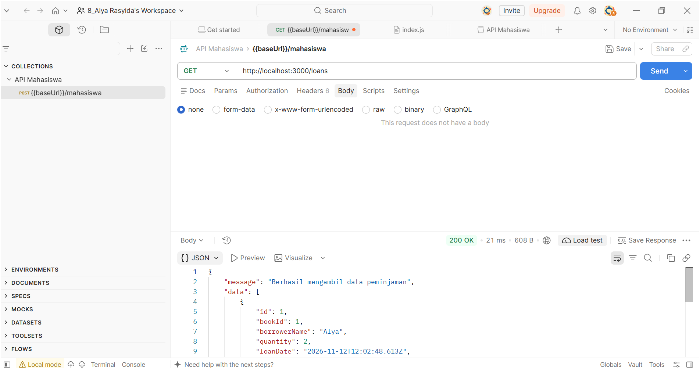

**7. POST Peminjaman**

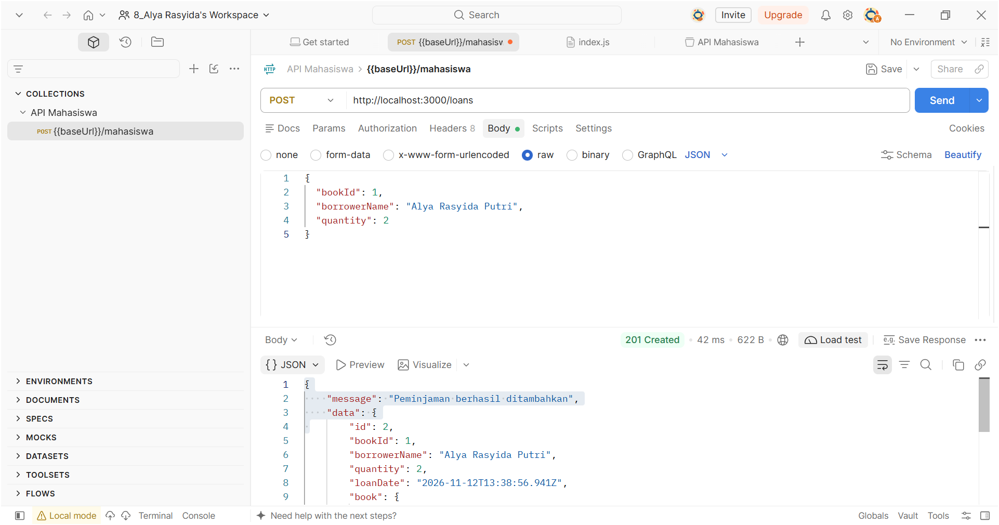

**8. Validasi Gagal (400)**

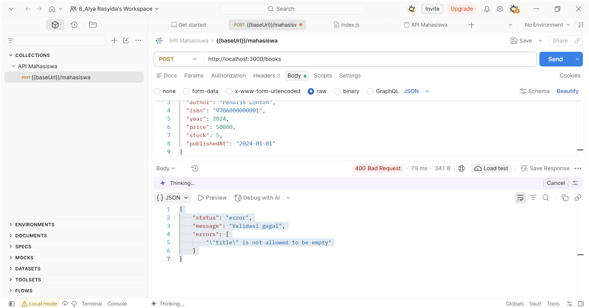

**9. Data Tidak Ditemukan (404)**

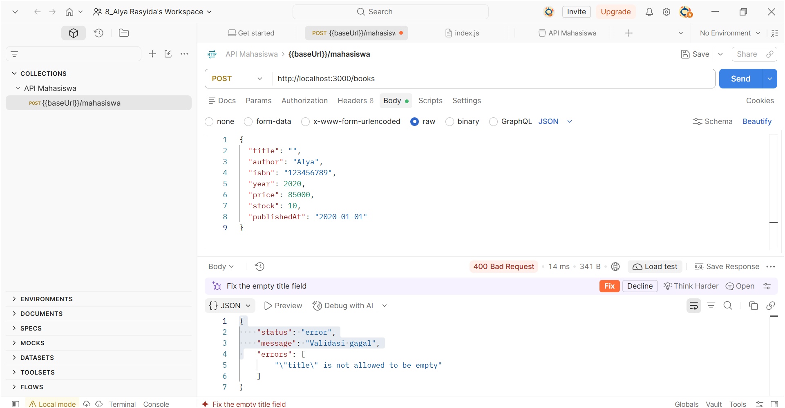

**10. Konflik ISBN (409)**

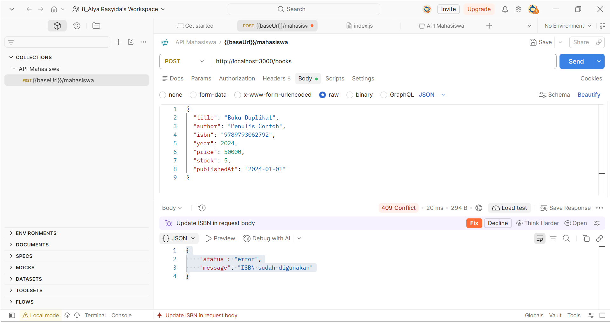

**11. Stok Tidak Mencukupi (422)**

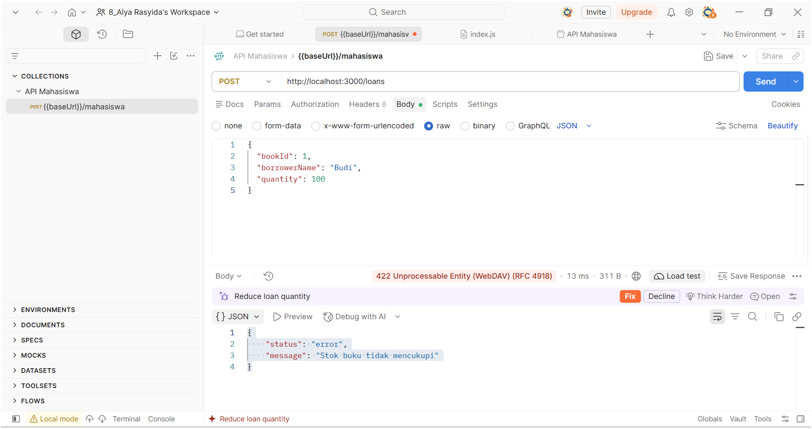

**12. Stok Sebelum Transaksi Gagal**

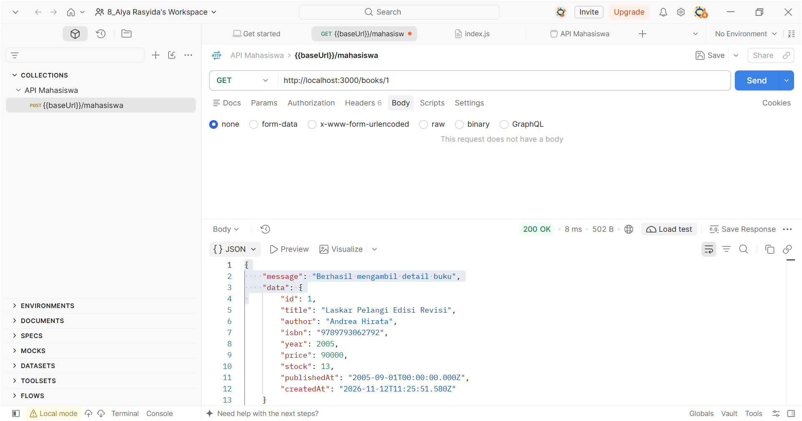

**13. Stok Setelah Transaksi Gagal**

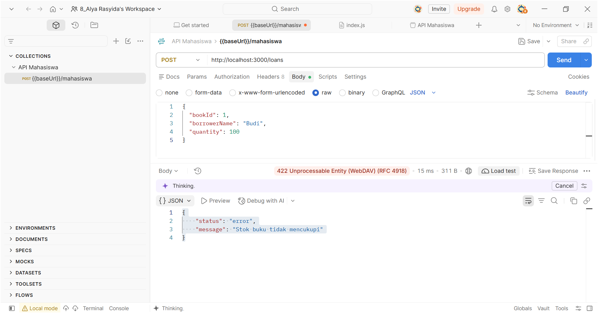

## Deklarasi Penggunaan AI

Dalam pengembangan project ini, AI digunakan sebagai alat bantu pembelajaran dan pendamping dalam proses pengerjaan, terutama untuk memahami konsep REST API, memberikan penjelasan kode, membantu proses debugging, serta memeriksa kesesuaian implementasi dengan ketentuan tugas.

Seluruh proses pengerjaan dipelajari dan diuji kembali secara mandiri, termasuk menjalankan server, menguji endpoint menggunakan Postman, serta memeriksa hasil operasi database.

## Link Video Presentasi

Video project dapat dilihat melalui tautan YouTube berikut:

[Link untuk menonton video](https://youtu.be/CogNcRW-dj4?feature=shared)